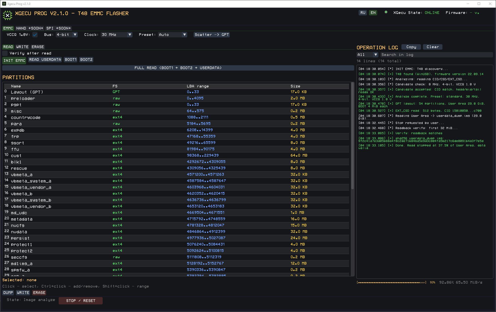

# Xgecu Prog

Xgecu Prog is a Windows application for working with eMMC chips through the
XGecu T48 programmer. The frontend is DearPyGui. The T48 link is WinUSB
(libwdi/Zadig driver), no vendor DLLs are involved.

This repository is a **GUI fork** of
[Xgecu-File-Manager](https://github.com/bepe3apng/Xgecu-File-Manager) by
[bepe3apng](https://github.com/bepe3apng): the backend (eMMC session,
protocol, operations, upstream feature modules) comes from the upstream
project, while the DearPyGui interface, the portable uv runtime and the
build pipeline in this fork are by **Soror L.'.L.'.'**.

Supported platforms: Windows 10/11 x64. Fully portable runtime - the
project brings its own Python 3.11 (via uv), no system Python is required.

*[Русская версия](README.ru.md)*

## Interface



## Quick start

```bat
install_xgecu_prog.bat
run_xgecu_prog.bat
```

The installer downloads a portable `uv.exe` into the project root, creates
the `xgecu_env` virtual environment (Python 3.11), installs dependencies
and checks fonts and critical imports. The launcher starts the app and
kills stale instances that hold the T48 USB handle.

Demo mode without hardware:

```bat
xgecu_env\Scripts\python.exe -X utf8 src\gui_dpg.py --demo
```

## Features

- eMMC init with auto-tuning of presets/clocks (8/16/20/30 MHz; 30 MHz
  experimental for THGA), CID/CSD/EXT_CSD readback.
- GPT/MBR layout parse with per-partition dump/write/erase; multi-row
  selection (click / Ctrl+click / Shift+click range).
- Read/write of BOOT1, BOOT2 and the whole User Area; sequential full
  operations with verification.
- Erase before write, erase verification, RAW skip of 00/FF fill after
  verified erase.
- EXT_CSD: 512/544-byte files, per-field write with readback
  confirmation, OTP dialogs for irreversible fields (162/178).
- RU/EN interface switch, colored operation journal with filter/search,
  status lamp (ONLINE/INIT/ERROR) probing the device like the INIT path.
- STOP support: bounded write streams, abort only outside an active
  stream.

NAND and SPI are placeholders. HS200/HS400 and 40 MHz modes are removed.

## Layout

```text
src/                       application code
  gui_dpg.py               DearPyGui frontend (entry point, --demo flag)
  orchestrator.py          task serialization, STOP, operation streams
  modes/emmc/              session, protocol, operations, extcsd, registers
  strings.py               RU/EN string table
assets/                    fonts, logo, icons, fixtures (gpt.bin, scatters)
cfg/                       probe JSON results and settings
logs/                      hardware logs, install.log
tests/                     smoke tests (run per file, mocked, no hardware)
docs/                      USER_GUIDE, OPERATIONS, EXT_CSD, ARCHITECTURE,
                           BUILD, TESTING, TROUBLESHOOTING, RESEARCH
docs/research/             probe scripts and investigations
bin/                       built EXE (gitignored)
xgecu_env/, .cache/, uv.exe, uvx.exe   portable runtime (gitignored)
```

## Building

```bat
compile_bin.ps1 -InstallBuildDeps
```

Produces `bin\T48_eMMC_dpg_v<version>.exe` (onefile, windowed; version
from `.version.cfg`). DPG build author: **Soror L.'.L.'.'.**
See [docs/BUILD.md](docs/BUILD.md).

## Tests

```bat
xgecu_env\Scripts\python.exe -X utf8 tests\smoke_layers.py
xgecu_env\Scripts\python.exe -X utf8 tests\smoke_stop.py
xgecu_env\Scripts\python.exe -X utf8 tests\smoke_verification.py
xgecu_env\Scripts\python.exe -X utf8 tests\smoke_autoconfig.py
xgecu_env\Scripts\python.exe -X utf8 tests\smoke_extcsd.py
```

All smokes are mocked and safe: no hardware writes. Current status and
hardware evidence are tracked in [docs/TESTING.md](docs/TESTING.md).

## Documentation

| Document | Contents |
|---|---|
| [User guide](docs/USER_GUIDE.md) | UI, init, read, write, erase, journal, STOP |
| [Operations](docs/OPERATIONS.md) | formats, RAW/Sparse, boundaries, erase control |
| [EXT_CSD](docs/EXT_CSD.md) | 512/544-byte files, writable fields, OTP dialogs |
| [Architecture](docs/ARCHITECTURE.md) | layers, threads, WinUSB, STOP model |
| [Build](docs/BUILD.md) | environment, dependencies, PyInstaller |
| [Testing](docs/TESTING.md) | smoke tests, factual results |
| [Troubleshooting](docs/TROUBLESHOOTING.md) | known errors and limitations |
| [Research](docs/RESEARCH.md) | probes, archived 40 MHz modes |

## Safety notes

- **Userdata means the whole hardware User Area**, not only the Android
  `userdata` partition.
- Erase covers the whole selected area, including the tail after a
  smaller image. RAW verification compares the entire file.
- EXT_CSD fields 162/178 are irreversible; the app asks for explicit
  confirmation and verifies by readback.
- The developers work with the hardware directly; the app reports what it
  verified and does not claim what it did not.

## Support

Telegram (developer chat): https://t.me/+7QS2hWrlAFw1Nzgy

Donations:

The support links for original backend author at his own repo:
[Xgecu-File-Manager](https://github.com/bepe3apng/Xgecu-File-Manager)
