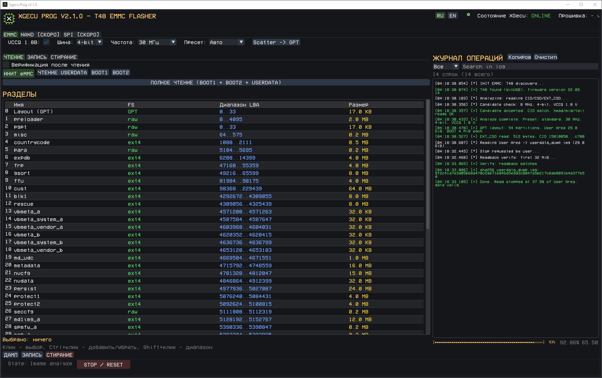

# Xgecu Prog

Xgecu Prog — приложение для Windows для работы с eMMC-чипами через
программатор XGecu T48. Активный фронтенд — DearPyGui; легаси-фронтенд на
Kivy сохраняется до завершения миграции. Связь с T48 — WinUSB
(драйвер libwdi/Zadig), без DLL производителя.

Этот репозиторий — **GUI-форк** проекта
[Xgecu-File-Manager](https://github.com/bepe3apng/Xgecu-File-Manager)
автора [bepe3apng](https://github.com/bepe3apng): бэкенд (сессия eMMC,
протокол, операции, модули фич из апстрима) взят из апстрим-проекта,
а DearPyGui-интерфейс, портативный рантайм на uv и сборочная линия этого
форка выполнены **Soror L.'.L.'.'**.

Поддерживаемые платформы: Windows 10/11 x64. Полностью портативный
рантайм — проект несёт собственный Python 3.11 (через uv), системный
Python не требуется.

*[English version](README.md)*

## Интерфейс



## Быстрый старт

```bat
install_xgecu_prog.bat
run_xgecu_prog.bat
```

Инсталлятор скачивает портативный `uv.exe` в корень проекта, создаёт
виртуальное окружение `xgecu_env` (Python 3.11), устанавливает
зависимости и проверяет шрифты и критические импорты. Лаунчер запускает
приложение и завершает зависшие инстансы, держащие USB-хэндл T48.

Демо-режим без оборудования:

```bat
xgecu_env\Scripts\python.exe -X utf8 src\gui_dpg.py --demo
```

## Возможности

- Инициализация eMMC с автоподбором пресетов/частот (8/16/20/30 МГц;
  30 МГц — экспериментальный для THGA), чтение CID/CSD/EXT_CSD.
- Разбор GPT/MBR с дампом/записью/стиранием по разделам; мультивыбор
  строк (клик / Ctrl+клик / Shift+клик — диапазон).
- Чтение и запись BOOT1, BOOT2 и всей User Area; последовательные полные
  операции с верификацией.
- Стирание перед записью, контроль стирания, пропуск RAW-заполнения
  00/FF после проверенного стирания.
- EXT_CSD: файлы 512/544 байта, запись полей с подтверждением и
  readback-проверкой, OTP-диалоги для необратимых полей (162/178).
- Переключатель интерфейса RU/EN, цветной журнал операций с фильтром и
  поиском, лампа статуса (ONLINE/INIT/ERROR) с пробом устройства тем же
  методом, что и INIT.
- Поддержка STOP: ограниченные потоки записи, отмена только вне активной
  поточной записи.

NAND и SPI — заглушки. Режимы HS200/HS400 и частоты 40 МГц удалены.

## Структура

```text
src/                       код приложения
  gui_dpg.py               DearPyGui-фронтенд (точка входа, флаг --demo)
  gui.py, gui.kv           легаси Kivy-фронтенд (миграция идёт)
  orchestrator.py          сериализация задач, STOP, потоки операций
  modes/emmc/              session, protocol, operations, extcsd, registers
  strings.py               таблица строк RU/EN
assets/                    шрифты, логотип, иконки, fixtures (gpt.bin, scatter)
cfg/                       probe-JSON и настройки
logs/                      hardware-логи, install.log
tests/                     smoke-тесты (запуск по одному, моки, без железа)
docs/                      USER_GUIDE, OPERATIONS, EXT_CSD, ARCHITECTURE,
                           BUILD, TESTING, TROUBLESHOOTING, RESEARCH
docs/research/             probe-скрипты и исследования
bin/                       собранный EXE (в gitignore)
xgecu_env/, .cache/, uv.exe, uvx.exe   портативный рантайм (в gitignore)
```

## Сборка

```bat
compile_bin.ps1 -InstallBuildDeps
```

Результат — `bin\T48_eMMC_dpg_v<версия>.exe` (onefile, windowed; версия
из `.version.cfg`). Автор сборки DPG: **Soror L.'.L.'.'.** Легаси-сборка
на Kivy (`T48_eMMC.spec` -> `dist\T48_eMMC.exe`) поддерживается.
Подробности — [docs/BUILD.md](docs/BUILD.md).

## Тесты

```bat
xgecu_env\Scripts\python.exe -X utf8 tests\smoke_layers.py
xgecu_env\Scripts\python.exe -X utf8 tests\smoke_stop.py
xgecu_env\Scripts\python.exe -X utf8 tests\smoke_verification.py
xgecu_env\Scripts\python.exe -X utf8 tests\smoke_autoconfig.py
xgecu_env\Scripts\python.exe -X utf8 tests\smoke_extcsd.py
```

Все smoke — на моках и безопасны: аппаратных записей нет. Текущий статус
и аппаратные доказательства — в [docs/TESTING.md](docs/TESTING.md).

## Документация

| Документ | Содержание |
|---|---|
| [Руководство пользователя](docs/USER_GUIDE.md) | интерфейс, инит, чтение, запись, стирание, журнал, STOP |
| [Операции и форматы](docs/OPERATIONS.md) | форматы, RAW/Sparse, границы, контроль стирания |
| [EXT_CSD](docs/EXT_CSD.md) | файлы 512/544 байта, записываемые поля, OTP-подтверждения |
| [Архитектура и протокол](docs/ARCHITECTURE.md) | слои, потоки, WinUSB, STOP |
| [Сборка и упаковка](docs/BUILD.md) | окружение, зависимости, PyInstaller |
| [Проверки и фактические результаты](docs/TESTING.md) | smoke-тесты, фактические результаты |
| [Диагностика и ограничения](docs/TROUBLESHOOTING.md) | известные ошибки, тайм-ауты, ограничения |
| [Исследовательские материалы](docs/RESEARCH.md) | probe-скрипты, архив 40 МГц |

## Примечания по безопасности

- **Userdata в приложении — вся аппаратная User Area**, а не только
  Android-раздел `userdata`.
- Стирание покрывает всю выбранную область, включая остаток после
  меньшего образа. Верификация RAW сравнивает весь файл.
- Поля EXT_CSD 162/178 необратимы; приложение запрашивает явное
  подтверждение и проверяет результат readback'ом.
- Разработчики работают с железом напрямую; приложение сообщает, что
  реально проверено, и не заявляет непроверенное.

## Поддержка

Telegram (чат разработки): https://t.me/+7QS2hWrlAFw1Nzgy

Поддержать разработчика:

Donations:

На авторской странице бэкэнда можете поблагодарить его автора 
[Xgecu-File-Manager](https://github.com/bepe3apng/Xgecu-File-Manager)
